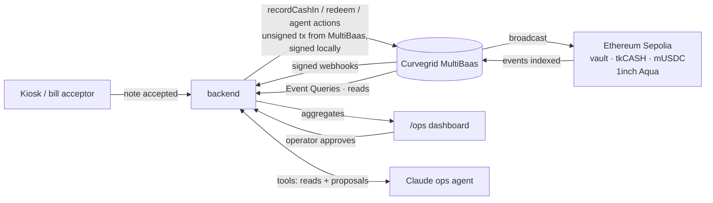
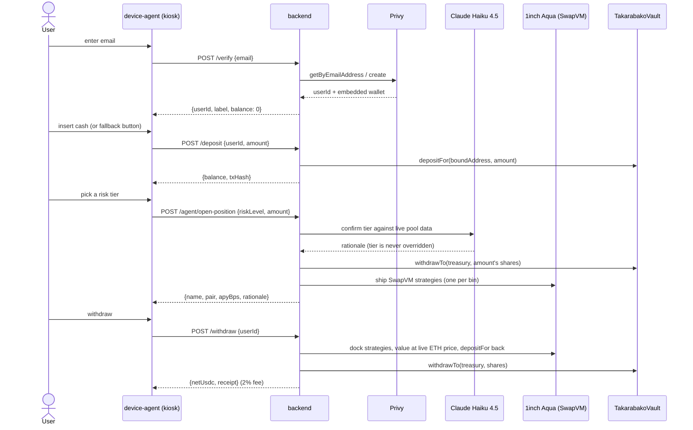

# Takarabako (宝箱)

**Takarabako turns banknotes into on-chain money: insert cash at a kiosk and it
becomes a yield-bearing USDC balance and a tokenized cash receipt (tkCASH) on
Ethereum Sepolia, Arc Testnet or Hedera Testnet (EVM side), with Circle CCTP moving USDC between Sepolia and Arc,
and one treasury dashboard and policy-bound AI agent watching all of them.**

An ATM-style cash-in kiosk: verify your identity with just an email (Privy —
real embedded wallet, no seed phrase, no app), *then* insert cash, and it's
credited to your wallet address (with a friendly label such as `alice-1a2b`
kept in Postgres) on the chain your kiosk is registered to, with optional
risk-tiered yield as 1inch Aqua liquidity strategies (Sepolia), with a Claude Haiku
4.5 call. Built for ETHGlobal Online 2026. Full product spec lives in
`takarabako-prd.md` (gitignored, local-only).

Nearly everything below is real, on Ethereum Sepolia and Arc Testnet — not a stub. See
[`DEPLOYMENTS.md`](./DEPLOYMENTS.md) for the full deployment history and
independent on-chain verification of each piece, and
[`FEEDBACK.md`](./FEEDBACK.md) for integration notes gathered along the way.

## Live deployments (Ethereum Sepolia, chain 11155111)

Our own five contracts are deployed **and independently verified on
Etherscan** (exact-match source, not just a bytecode match) — click through
to confirm:

| Contract | Address | Etherscan |
|---|---|---|
| `MockUSDC` | `0x6cc5f175810e61A56508049f0527BC75EB7e77e4` | [Verified ✅](https://sepolia.etherscan.io/address/0x6cc5f175810e61A56508049f0527BC75EB7e77e4#code) |
| `TakarabakoVault` | `0xD069D36Af7DF950EE87002Fc120B90eF5Ea3ce3D` | [Verified ✅](https://sepolia.etherscan.io/address/0xD069D36Af7DF950EE87002Fc120B90eF5Ea3ce3D#code) |
| `MockRiskToken (mAAVE)` | `0x9c57968055d77d765e4EF1E4F138e9089295eD04` | [Verified ✅](https://sepolia.etherscan.io/address/0x9c57968055d77d765e4EF1E4F138e9089295eD04#code) |
| `MockRiskToken (mDOGE)` | `0x071436DC66a7C86a7c12Bc7E337A05fb46908c38` | [Verified ✅](https://sepolia.etherscan.io/address/0x071436DC66a7C86a7c12Bc7E337A05fb46908c38#code) |
| `TakarabakoCashReceipt (tkCASH)` | `0x8023edf927c0a53f5620998f972b3d0740e04ea9` | [Verified ✅](https://sepolia.etherscan.io/address/0x8023edf927c0a53f5620998f972b3d0740e04ea9#code) |

Everything else the app talks to is a canonical, already-verified deployment
we don't own — real Uniswap v3 (Factory/NPM/WETH9), 1inch Aqua and Circle's
CCTP contracts. Full addresses, how each was
independently confirmed on-chain (not just trusting a tx receipt), and the
per-risk-tier pool addresses are all in [`DEPLOYMENTS.md`](./DEPLOYMENTS.md).

Live app deployment:

| Component | URL |
|---|---|
| Kiosk demo | https://takarabako-kiosk.netlify.app |

## Curvegrid MultiBaas — all three tracks

One build covers the three Curvegrid prizes, with MultiBaas as the
backend's contract layer and indexer:

| Track | What we built | Where |
|---|---|---|
| **RWA tokenization** | **tkCASH** — a token that is a claim on one US dollar of banknotes in a specific kiosk. Minted when a note is accepted, burned when cash leaves; supply always equals the on-chain kiosk reserve. Operator counts (`attestReserve`) are proof-of-reserve checkpoints — a mismatch freezes that kiosk's minting. Transfers need both sides allowlisted (Privy-verified), respect a daily limit and a global pause. | `contracts/src/TakarabakoCashReceipt.sol`, `backend/src/cashReceipt.ts` |
| **Digital asset dashboard** | **`/ops`** — proof of reserve per kiosk, tkCASH backing, vault coverage, treasury gas, banknote mix, daily cash in/out, holders and concentration, vault depositors, 1inch Aqua strategies, a live event feed and action items. | `frontend/app/ops/`, `backend/src/routes/dashboard.ts` |
| **AI agent** | A **treasury ops agent** (Claude) that answers operators from live MultiBaas data and can only *propose* actions — fund the yield reserve, set APY, pause a kiosk, mint float. Hard limits are enforced in code; a human approves; approval executes through MultiBaas. A monitor watches webhook events and wakes the agent on anomalies. | `backend/src/opsAgent.ts`, `policy.ts`, `opsMonitor.ts` |

### How we used MultiBaas

- **Contract calls and unsigned transactions.** Every tkCASH write and every
  approved agent action is built by MultiBaas's contract API from the
  uploaded ABI, returned unsigned, signed locally with the treasury key, and
  broadcast through `POST /chains/ethereum/transactions/submit`. The key
  never leaves the backend and no Cloud Wallet is needed
  (`backend/src/multibaas.ts`, `mbSend`).
- **Reads** of the vault, tkCASH and mUSDC go through the same API
  (`mbCall`), including the customer's live vault value on `/position`.
- **Address aliases** name the contracts (`vault`, `tkcash`, `musdc`,
  `treasury`) and each new customer's wallet (their label).
- **Saved Event Queries** power the dashboard: `cash_in_by_kiosk`,
  `cash_in_by_denomination`, `tkcash_holders` (balances rebuilt from
  Transfer events with `add`/`subtract` aggregators), `deposits_by_user`,
  `withdrawals`, `reserve_attestations`.
- **Signed webhooks** stream every event to `/webhooks/multibaas`
  (HMAC-SHA256 over body + timestamp, verified, replays rejected) into a
  Postgres event log that feeds the flows chart, the live feed and the
  agent's monitor.
- `npm run mb:setup` does all of the setup idempotently: five ABIs (the
  free tier's cap), aliases, links from the latest block, the queries and
  the webhook.



### Team

- **belulok** — [github.com/belulok](https://github.com/belulok)
- **nizarsyahmi37** — [github.com/nizarsyahmi37](https://github.com/nizarsyahmi37)
- **AqilJaafree** — [github.com/AqilJaafree](https://github.com/AqilJaafree)

### Our experience with MultiBaas

See the MultiBaas section of [`FEEDBACK.md`](./FEEDBACK.md#feedback-curvegrid-multibaas)
for what worked, what tripped us up, and suggestions.

## Chains: Ethereum Sepolia, Arc Testnet and Hedera Testnet

Takarabako runs on every chain in `ENABLED_CHAINS` at once. Each chain has its
own `TakarabakoVault`, its own tkCASH and its own USDC; one treasury key signs
on all of them.

| | Ethereum Sepolia | Arc Testnet | Hedera Testnet (EVM side) |
|---|---|---|---|
| Chain id | 11155111 | 5042002 | 296 |
| USDC | Circle's Sepolia USDC (the vault must use it for CCTP to work) | `0x3600…0000` (6 decimals as an ERC-20) | Circle's native USDC, a Hedera Token Service token (`0.0.429274`) through its ERC-20 facade `0x…068cda` |
| Gas | ETH | USDC (the same funds as the USDC balance, 18-decimal gas view) | HBAR |
| Indexing | Curvegrid MultiBaas | the backend's own log reader (`logIndexer.ts`) | the same log reader, in 900-block steps (the relay caps a query at 1,000) |
| CCTP bridge | yes | yes | no: top it up from the treasury |
| 1inch Aqua yield | yes | not deployed there | not deployed there |

Hedera is the EVM side only: the same vault and tkCASH contracts through Hedera's
JSON-RPC relay (Hashio by default). Deposits are converted to USD at the same live
rate as everywhere else, and USDC is 1:1 with USD, so the box is credited the
equivalent amount of Hedera USDC. A contract can only hold an HTS token after it
has been associated with it, so Hedera uses `TakarabakoVaultHedera`, which associates
itself with USDC when it is created; no other contract differs. Native Hedera
features (HBAR payments, `0.0.x` account ids) are not part of this.

- A kiosk is registered to one **home chain**; the notes it takes are credited
  there (vault `depositFor`, tkCASH `recordCashIn`).
- A customer's box is one account (the same vault address on every chain) with a
  balance on each. **My box** shows the total and the split.
- **tkCASH never crosses chains.** It is a claim on cash in a specific kiosk's
  box, so each chain has its own tkCASH and its own proof of reserve. Only USDC
  moves between chains.
- Deploy a chain's contracts with your own treasury key:
  ```bash
  cd contracts
  # Arc Testnet (sends need maxFeePerGas >= 20 gwei)
  forge script script/DeployCashChain.s.sol --rpc-url https://rpc.testnet.arc.io \
    --broadcast --private-key $TREASURY_PRIVATE_KEY --with-gas-price 25gwei --legacy
  # Hedera Testnet: Hedera's system contracts don't exist in forge's local simulation
  HEDERA=1 USDC_ADDRESS=0x0000000000000000000000000000000000068cda \
    forge script script/DeployCashChain.s.sol --rpc-url https://testnet.hashio.io/api \
    --broadcast --private-key $TREASURY_PRIVATE_KEY --skip-simulation --legacy
  # Ethereum Sepolia against Circle's USDC, so it can be bridged
  USDC_ADDRESS=0x1c7D4B196Cb0C7B01d743Fbc6116a902379C7238 forge script script/DeployCashChain.s.sol \
    --rpc-url $SEPOLIA_RPC_URL --broadcast --private-key $TREASURY_PRIVATE_KEY
  ```
  Then put the printed addresses in `backend/.env` (`ARC_TESTNET_VAULT_ADDRESS`,
  `ARC_TESTNET_CASH_RECEIPT_ADDRESS`, …; see `.env.example`). The treasury needs
  testnet USDC on each chain (Circle's faucet; on Hedera, 20 USDC per request) and gas
  (Sepolia ETH, Arc USDC, Hedera HBAR). Enable Hedera with
  `ENABLED_CHAINS=sepolia,arc-testnet,hedera-testnet` and the `HEDERA_TESTNET_*` values.

## Bridging USDC with CCTP (Sepolia and Arc)

`/bridge` in the web app moves USDC from a customer's box on one chain to their
box on the other, with Circle's CCTP V2 (standard transfer, no fee):

1. the USDC leaves the customer's box on the source chain (vault withdrawal to
   the treasury);
2. the treasury burns it with `depositForBurn`;
3. Circle's attestation service signs the burn once the source chain is final
   (about 20 minutes from Sepolia, a few from Arc);
4. the treasury mints it on the destination chain with `receiveMessage`;
5. the minted USDC is deposited into the customer's box there.

Every step is stored in Postgres before the next one starts, so a backend
restart resumes a transfer instead of burning twice. Operators can also
rebalance the treasury's own float between chains from `/ops`, and the ops agent
can propose the same (always needs a human). `npm run bridge:smoke --
sepolia arc-testnet 1` moves $1 of treasury USDC end to end.

## Labels, kiosks and the daily limit

- **Accounts** are identified by their Privy wallet address. A label derived
  from the email (`alice-1a2b`) is stored in Postgres as a friendly handle, and
  people send to each other by label or by address.
- **Verifiable kiosks.** Each kiosk generates a signing key on its own device
  (`device-agent/machine.js`) and signs every note it takes (EIP-712
  `NoteAccepted`). An operator registers the key's public address against the
  kiosk id and its home chain:
  ```bash
  cd backend && npm run kiosk:register -- tokyo-01 0xDEVICE_ADDRESS sepolia
  ```
  (or `POST /ops/kiosks` with the operator token). A note counts as
  machine-verified only if it is signed by the registered key of an active
  kiosk; replays are rejected. `MACHINE_SIGNATURE=required` refuses unsigned
  deposits outright.
- **One daily limit.** Every account can move `DAILY_LIMIT_USD` a day (default
  $1,000) across deposits, withdrawals, yield, sends and bridging. Set the tkCASH
  contract's daily transfer limit to the same figure (`DeployCashChain` does).

## Yield on 1inch Aqua

Customers put their box to work as ETH/USDC liquidity through
[1inch Aqua](https://github.com/1inch/aqua), the shared-liquidity registry,
and SwapVM strategies from [`@1inch/swap-vm-sdk`](https://github.com/1inch/sdks).
Aqua and its SwapVM router are live on Sepolia (the SDK doesn't list Sepolia;
the router is at its previous address, `0x1111113d…c0de`, version 1.0.2).
The pair is mETH (a mintable ETH stand-in priced off live ETH/USD) and mUSDC.

- **Quick start** — three tiers for beginners: *Steady* (full-range x·y=k),
  *Balanced* (±25% concentrated) and *Bold* (±8%), each with a one-line Claude
  rationale.
- **Advanced** — drag a price range on a week of ETH/USD (log scale, −90% to
  +300%) and pick a shape: *Spot* (even), *Curve* (weighted to the current
  price) or *Bid-Ask* (weighted to the edges). The range is split into up to
  five bins, each its own concentrated SwapVM strategy; bins wholly below the
  price are USDC-only bids, wholly above are ETH-only asks, so a −90%…−3%
  range is a one-sided "buy the dip" ladder. Token amounts come from SwapVM's
  liquidity maths so every strategy starts at the market price.
- **Money flow** — opening takes the amount out of the customer's vault; the
  treasury is the Aqua maker and ships the strategies (tokens stay in its
  wallet, Aqua tracks virtual balances). Closing — or withdrawing — docks
  them and returns their value at the live ETH price to the vault.
- **Demo market maker** — nobody trades on Sepolia, so with `AQUA_SIM=1` the
  treasury trades against its own strategies every 10 minutes (at most two
  swaps), pulling mispriced ones toward the live price or making a small
  round trip so fees accrue.
- The 1inch hosted Swap API doesn't serve Sepolia; everything here talks to
  the Aqua and SwapVM contracts directly through the SDKs.

## Layout

- **`contracts/`** — Foundry workspace: `MockUSDC`, mock risk-tier tokens,
  `TakarabakoVault` (mock-yield ERC-4626-flavored vault) and
  `TakarabakoCashReceipt` (tkCASH).
- **`backend/`** — Node/TypeScript orchestrator: real Privy identity, a
  label and kiosk registry in Postgres, vault deposit/withdraw on two chains,
  CCTP bridging, real per-user
  1inch Aqua yield strategies (beginner tiers and a drawable advanced range), real Claude Haiku 4.5
  rationale.
- **`frontend/`** — Next.js web app: the customer app (Privy email-code
  login, live balance, quick-deposit QR, yield, withdraw), `/kiosk`, the
  box's new screen, `/deposit`, the public cash-deposit terminal (wallet QR
  login), `/bridge`, and
  `/ops`, the combined treasury dashboard for both chains. See [`frontend/README.md`](./frontend/README.md).
- **`device-agent/`** — kiosk page for the Raspberry Pi 4 touchscreen, plus
  the software bridge for a real TB74 pulse bill acceptor (`gpio/`).

## System flow



## Quickstart

```bash
# contracts
cd contracts && forge install --no-git && forge test

# backend — needs real Sepolia RPC/keys in .env; see DEPLOYMENTS.md
cd backend && npm install && cp .env.example .env
npm run services   # Postgres + Redis without Docker (or: docker compose up -d)
npm run dev        # http://localhost:4000

# web app + /kiosk + /ops (separate shell)
cd frontend && npm install && npm run dev   # http://localhost:3000

# Pi kiosk page (separate shell)
cd device-agent && cp public/config.example.js public/config.js && node server.js   # http://localhost:8080
```

### MultiBaas setup

1. Create a free Sepolia deployment at [console.curvegrid.com](https://console.curvegrid.com)
   and an admin API key (Admin → API Keys). Put them in `backend/.env` as
   `MULTIBAAS_URL` and `MULTIBAAS_API_KEY`. No CORS setup is needed: the
   browser never calls MultiBaas; the dashboard goes through the backend.
2. tkCASH is already deployed at `0x8023edf927c0a53f5620998f972b3d0740e04ea9`; set `CASH_RECEIPT_ADDRESS` to it. To deploy your own:
   ```bash
   cd contracts
   KIOSK_ID=tokyo-01 forge script script/DeployCashReceipt.s.sol --rpc-url $RPC_URL --broadcast --private-key $PRIVATE_KEY
   ```
3. Expose the backend for webhooks, e.g. `cloudflared tunnel --url http://localhost:4000`,
   and set `PUBLIC_BACKEND_URL` to the tunnel URL.
4. `cd contracts && forge build && cd ../backend && npm run mb:setup` —
   uploads the ABIs, links addresses, saves the queries and registers the
   webhook. Copy the printed `MULTIBAAS_WEBHOOK_SECRET` into `.env` and
   restart the backend.
5. Set `OPS_ADMIN_TOKEN` (a long random string) to use the agent and approve
   proposals on `http://localhost:3000/ops`.

### Testing

```bash
cd contracts && forge test          # vault, tkCASH and one cash chain's flows (35 tests, incl. a supply == reserve fuzz)
cd backend && npm test              # needs Postgres + Redis (npm run services); 193 tests:
                                    # webhook signatures, tkCASH encoding, policy limits,
                                    # proposal lifecycle with the executor stubbed, monitor
                                    # rules, kiosk keys, the daily limit, CCTP helpers, …
cd backend && npm run typecheck
```

Two end-to-end checks run against local nodes, with no testnet funds (see the
header of each script for the setup): `npm run arc:e2e` exercises a second
chain's vault, tkCASH, event log and dashboard panels; `npm run bridge:e2e`
runs the real bridge state machine between two local chains with a stand-in
for Circle's CCTP contracts (`contracts/test/mocks/MockCctp.sol`), including
resuming a transfer after a restart.

End to end: log in at the kiosk and insert a note (or use the test-deposit
button), then check `/ops` — a CashIn arrives by webhook, the reserve and
holders update. Ask the agent "Is the yield reserve sufficient?" (grounded
answer + tool trace), then "Raise APY to 50%" (policy rejects it), then "Top
up the yield reserve with 100 USDC" (pending → Approve → the tx appears in
MultiBaas and the feed).

Treasury wallet is a testnet-only burner key — check its Sepolia ETH
balance before running anything that spends gas; it runs dry easily at
hackathon pace.
